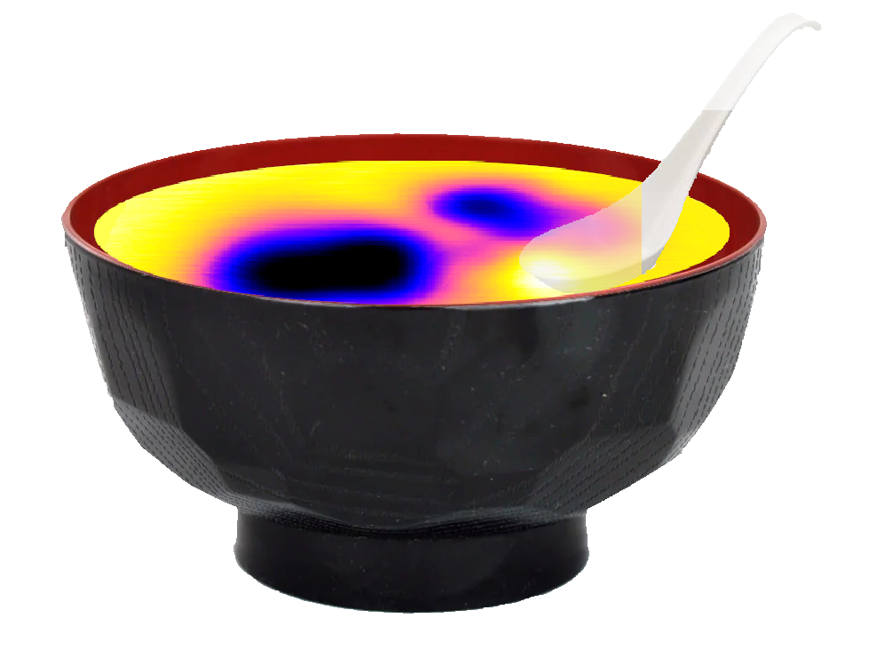

# SXM Viewer

SXM Viewer is a Python-based desktop application for scientific SPM (Scanning Probe Microscopy) data analysis and visualization, designed for Anfatec/Omicron systems. But also Nanonis. Maybe in the future Matrix. We will see.

> **Attribution:** The original SXM Viewer is developed by Ex-libris and available at
> https://github.com/Ex-libris/sxm_viewer. This repository extends it with the in-house
> MISO molecule-analysis tools.

---

## Documentation

Full documentation is available at:

https://ex-libris.github.io/sxm_viewer/

Key pages:
- Installation: https://ex-libris.github.io/sxm_viewer/getting-started/installation/
- First Steps: https://ex-libris.github.io/sxm_viewer/getting-started/first-steps/
- Profiles and Measurements: https://ex-libris.github.io/sxm_viewer/image-analysis/profiles/

---

## Overview

SXM Viewer provides an integrated environment for:

- Fast browsing of large SPM datasets
- Image analysis (profiles, angles, cropping, filtering)
- Spectroscopy visualization (traces, matrix scans, KPFM)
- Overlay tools (molecules, metadata, scale bars)
- Publication-ready figure composition (canvas)
- Session and collection management


## Quick start

```powershell
git clone https://github.com/Ex-libris/sxm_viewer.git
cd sxm_viewer
conda create -n sxmviewer python=3.11
conda activate sxmviewer
cd .\scripts
python -m pip install -r .\requirements.txt
cd ..
python -m sxm_viewer
```

See the full installation guide in the MkDocs site for the Windows installer helper and troubleshooting notes.

### Start with a click (desktop icon)

After installing, you can start the program from an icon, with no terminal and no manual
environment activation. Windows and Linux are supported, with a venv or a conda environment.

* **Installer:** `scripts/install_sxm_viewer.bat` (or `python scripts/install.py`) offers to
  create the icon at the end. Answer Y, or press Enter. To skip the question, add
  `--no-launcher`.
* **Any other environment (for example conda), or later:** activate the environment you
  use, then run once:

  ```powershell
  python scripts\create_launcher.py
  ```

  Add `--dry-run` to see what would be created without writing anything. The environment
  that runs the script is the one the icon starts, so run it again on each computer, and
  again if you move the folder or recreate the environment.

What you get:

| System | Icon |
|---|---|
| Windows | "MISO GUI" shortcut on the Desktop, no console window (conda uses a hidden launcher that activates the environment first) |
| Linux | "MISO GUI" entry in the application menu and a copy on the Desktop |

The generated files go to a `launchers/` folder that git ignores, because they contain
paths of your computer. If the icon opens nothing, start the program once from a terminal
(`python -m sxm_viewer`, or `scripts\run_sxm_viewer.bat`) to read the error message.
macOS is not supported by the icon script.


---
## MISO Tools



MISO is an in-house extension of SXM Viewer for molecule analysis on STM images. It provides a set of tools that bridge the SXM Viewer interface with the MISO processing pipeline.

### Overview

The MISO pipeline takes STM scan data and a set of manually selected molecule positions 
as input, runs a polymer conformation analysis, and returns optimized molecular structures 
in SDF format. The tools below integrate this workflow directly into SXM Viewer.

### Tools

#### Position Coordinates
*Tools → Position coordinates...*

Allows manual selection of molecule positions directly on the STM preview image. 

- Toggle **Pick mode** and click on molecules in the image
- Each click records the XY position in Angstrom and the local height Z from the scan data
- Points are displayed as numbered markers on the image
- Use **Clear last** or **Clear all** to correct mistakes
- Export the collected positions as a CSV file (`circle_input_path`) compatible with the 
  MISO pipeline
- The STM grid is automatically exported as an NPZ file alongside the CSV, containing 
  the full X, Y, Z arrays in Angstrom (`stm_grid_path`)

#### YAML Config Upload
*Tools → Position coordinates... → Browse YAML*

Select an existing MISO pipeline YAML configuration file from within the viewer. 
The YAML defines pipeline parameters including the molecule type, grid path, and 
output directories.

#### Run MISO
*Tools → Run MISO...*

Runs the MISO engine (`MISO/module_B.py`) locally from within the viewer — no job
script or terminal required.

- Select the **Config YAML** and the **Positions CSV** exported from *Position coordinates*
- Set the run parameters:
  - **Iterations** — rotation-search samples per monomer during alignment
  - **Polymers** — number of independent structures to generate
  - **Compression steps** — MD steps in the slab-compression phase (exported as `DEFAULT_COMPRESSION_STEPS`)
  - **Gravity** — surface gravity scale (exported as `DEFAULT_GRAVITY`)
- Click **Run MISO** — the engine runs as a subprocess and its output streams live
  into the log panel; **Stop** cancels it
- On success, results are written to a `results/` folder next to the CSV, and every
  exported `.sdf` is auto-converted to `.mol` and `.mol2`

> The runner uses only the YAML + CSV (uniform surface gravity). It does not require
> the STM grid NPZ.

**Updating the MISO engine.** Replace the contents of the `MISO/` folder with the new
version and press **Run MISO**. Before each run the viewer reads `MISO/module_B.py`,
sends only the command line options that version accepts, and writes lines starting with
`[MISO] Note:` at the top of the log. These say which options were skipped, whether the
compression steps or gravity values may be ignored, and whether a YAML section such as
`Phosphate` or `PEtN` is no longer mentioned by the engine. If the viewer cannot drive the
new version at all, it stops with a message before anything runs.

### Workflow

1. Open your SXM scan in SXM Viewer
2. Open **Tools → Position coordinates**
3. Toggle **Pick mode** and click on each molecule visible in the image
4. Click **Export CSV** — this saves both the positions CSV and the STM grid NPZ
5. Open **Tools → Run MISO...**
6. Select the YAML config and the exported positions CSV
7. Set **Iterations / Polymers / Compression steps / Gravity**, then click **Run MISO**
8. Optimized `.sdf` (plus `.mol` / `.mol2`) structures appear in the `results/` folder next to the CSV

> For large batch runs you can instead submit `MISO/module_B_scratch.job` on the
> cluster — see `MISO/README.md` for the CLI and job-script instructions.

### File Outputs

| File | Description |
|------|-------------|
| `<image>_positions.csv` | Molecule positions: Point, Original_X, Original_Y, X (Angstrom), Y (Angstrom), Height, Z (Angstrom) |
| `<image>_positions.npz` | Full STM grid arrays: x, y (Angstrom axes), z (height map in Angstrom) |
